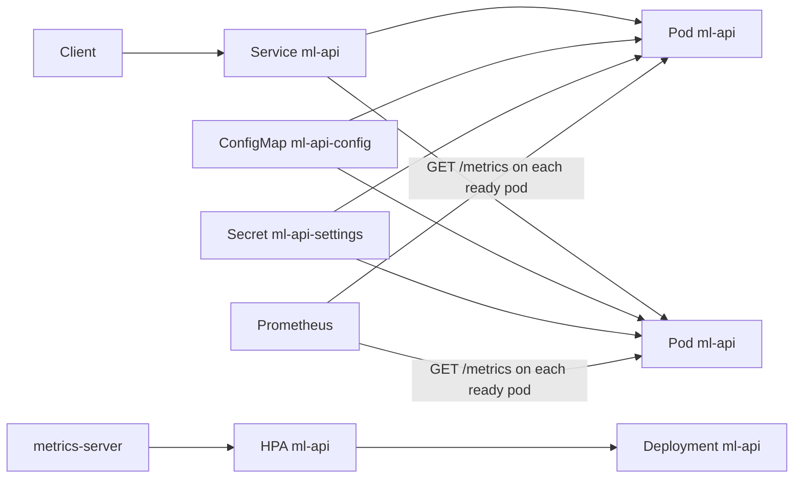

# ML API Monitor

**ML API Monitor is a single-process FastAPI demo that exposes image inference and measures latency, confidence, errors, prediction behavior, and a simple confidence-distribution drift signal.**

The service has a validated HTTP boundary, measured inference, structured process logs, operational metrics, statistical monitoring, tests, and a reproducible demo. It runs locally on CPU without a dataset or external service.

## Why This Project Exists

Deploying a model is only one part of the ML lifecycle. After deployment, an engineer needs to know whether requests succeed, inference is getting slower, confidence is changing, and unusual traffic may need investigation. This project turns those concerns into a runnable service rather than a notebook-only experiment.

## What I Built

- A FastAPI `POST /predict` endpoint for image uploads.
- A deterministic `tiny-color` brightness and color heuristic for repeatable demos. It is not a trained model.
- An optional `mobilenet_v3_small` path using torchvision pretrained weights.
- Measured inference-only latency and confidence in every successful response.
- JSON prediction logs without raw image contents.
- Thread-safe in-memory monitoring with request, success, error, latency, confidence, and prediction counters.
- Prometheus-compatible `GET /metrics` output and a Streamlit dashboard.
- A two-sample KS test comparing baseline and recent confidence windows.
- Automated tests plus live smoke and synthetic stress-input demo scripts.


## Architecture

```mermaid
flowchart TD
    A[Client image] --> B[FastAPI /predict]
    B --> C[Upload limits and Pillow decode]
    C --> D[Image preprocessing]
    D --> E[Default brightness/color heuristic or optional MobileNet]
    E --> F[Prediction, confidence, inference latency]
    F --> G[JSON prediction log]
    F --> H[In-memory monitor]
    H --> I[Prometheus-compatible /metrics]
    H --> J[Baseline and recent confidence windows]
    J --> K[KS drift detector]
    K --> L[/monitoring JSON and Streamlit dashboard]
    M[/health and /readyz] --> B
    N[/livez] --> B
```

The log stream is structured process output. Drift is calculated from the monitor's bounded confidence windows, not by parsing logs.

## Technologies

| Area | Choice | Why |
| --- | --- | --- |
| API | FastAPI, Uvicorn | Typed HTTP API with generated OpenAPI docs |
| Validation | Pydantic, Pillow | Structured responses and safe image decoding |
| Inference | NumPy default; optional PyTorch/torchvision | The default path is a brightness/color heuristic and needs no checkpoint; optional MobileNet uses pretrained torchvision weights |
| Monitoring | In-memory monitor, Prometheus text format | Minimal local deployment with standard metric names |
| Drift | SciPy two-sample KS test | Explainable comparison of confidence distributions |
| UI | Streamlit | Small monitoring view for demonstrations |
| Testing | Pytest, FastAPI TestClient | Deterministic unit and API coverage |
| Deployment | Docker, Kubernetes, Prometheus, kind | Local cluster with probes, an HPA, and a per-pod scrape |

## Project Structure

```text
ml-api-monitor/
├── app/
│   ├── config.py          # validated environment settings
│   ├── drift.py           # KS confidence drift detector
│   ├── logging_config.py  # JSON logging formatter
│   ├── main.py            # FastAPI application and endpoints
│   ├── model.py           # default and optional model adapters
│   ├── monitoring.py      # thread-safe in-memory metrics
│   └── schemas.py         # API response contracts
├── dashboard/app.py       # Streamlit monitoring dashboard
├── data/README.md         # dataset guidance; no dataset committed
├── diagrams/architecture.mmd
├── scripts/
│   ├── generate_demo.py   # synthetic stress-input traffic generator
│   └── smoke_test.py      # live endpoint check
├── tests/                 # API, monitoring, drift, and config tests
├── deploy/
│   ├── k8s/               # API, HPA, and Prometheus manifests
│   └── kind/              # kind cluster config and metrics-server patch
├── scripts/install_k8s_tools.sh
├── scripts/k8s_smoke.sh
├── .github/workflows/ci.yml
├── .env.example
├── requirements-dashboard.txt
├── requirements-mobilenet.txt
├── pyproject.toml         # pytest discovery configuration
├── requirements.txt
├── Dockerfile
├── Makefile
└── README.md
```

## Setup

Requirements:


```powershell
python -m venv .venv
.venv\Scripts\Activate.ps1
python -m pip install -r requirements.txt
Copy-Item .env.example .env
```

The default `tiny-color` path is a brightness and color heuristic, not a trained classifier. It requires no checkpoint download and does not require Torch. The optional MobileNet path requires a compatible Torch/torchvision installation and may download pretrained weights on first use:

```powershell
python -m pip install -r requirements-mobilenet.txt
$env:MODEL_NAME = "mobilenet_v3_small"
```

## Run the Service

Start the API in one terminal:

```powershell
uvicorn app.main:app --reload
```

Then open the interactive API documentation at http://127.0.0.1:8000/docs.

### API Examples

Health:

```powershell
curl.exe http://127.0.0.1:8000/health
```

```json
{"status":"ok","model_loaded":true}
```

Prediction:

```powershell
curl.exe -X POST -F "file=@path\to\image.png" http://127.0.0.1:8000/predict
```

```json
{
  "prediction": "bright-scene",
  "confidence": 0.998,
  "latency_ms": 0.42,
  "timestamp": "2026-09-29T12:00:00+00:00"
}
```

Monitoring:

```powershell
curl.exe http://127.0.0.1:8000/metrics
curl.exe http://127.0.0.1:8000/monitoring
```

Invalid, empty, oversized, corrupt, or over-large-pixel uploads return a client error without exposing an internal traceback. The default limits are 5 MB and 4 million pixels.

## Demonstration Workflow

With the API running, use the reproducible synthetic traffic generator:

```powershell
python scripts/generate_demo.py
```

It submits ten normal-looking and ten synthetic contrast images and prints measured confidence means, latency mean, latency p95, and drift status. These are stress inputs for demonstrating monitoring mechanics, not a benchmark dataset or a validated OOD evaluation.

Run the dashboard in another terminal:

```powershell
python -m pip install -r requirements-dashboard.txt
streamlit run dashboard/app.py
```

For a quick end-to-end check:

```powershell
python scripts/smoke_test.py
```

## Monitoring and Drift

The monitor records:

- request, success, and error counts
- a bounded sample of inference latency and confidence, plus running sums
- prediction counts and a short list of recent events
- separate baseline and recent confidence windows used by the drift check

The first `BASELINE_WINDOW` successful predictions become the reference window. Later successful predictions fill the recent window. The detector is a two-sample Kolmogorov-Smirnov test. If either window has fewer than two values, the status is `INSUFFICIENT_DATA` and no p-value is reported. Once both windows have at least two values, a p-value below `DRIFT_THRESHOLD` reports `DRIFT`; otherwise it reports `NO_DRIFT`.

Confidence drift is only a monitoring proxy. It does not prove that the input distribution changed, and an OOD image can still receive a high-confidence incorrect prediction.

## Configuration

Settings are read from environment variables and validated at startup:

| Variable | Default | Description |
| --- | ---: | --- |
| `MODEL_NAME` | `tiny-color` | `tiny-color` or `mobilenet_v3_small` |
| `DRIFT_METHOD` | `ks` | The only implemented detector currently supported |
| `DRIFT_THRESHOLD` | `0.05` | KS p-value threshold, exclusive range 0 to 1 |
| `BASELINE_WINDOW` | `20` | Minimum 2 reference confidence values |
| `RECENT_WINDOW` | `20` | Minimum 2 recent confidence values |
| `MAX_UPLOAD_BYTES` | `5000000` | Maximum uploaded image size |
| `MAX_IMAGE_PIXELS` | `4000000` | Maximum decoded image area |
| `LOG_LEVEL` | `INFO` | `DEBUG`, `INFO`, `WARNING`, `ERROR`, or `CRITICAL` |

## Deploying on Kubernetes

Each API pod runs one Uvicorn process. The Deployment keeps two pods available, probes the real health endpoints before sending traffic, and Prometheus scrapes `/metrics` on each ready pod. Counters and drift windows stay inside the process that recorded them. A second replica does not share that state. Prometheus is what aggregates the series.



### Quickstart

Prerequisites: Docker, GNU Make, curl, Python 3.12 with the dependencies in `requirements.txt`, and `kind`, `kubectl`, and `kubeconform` on `PATH`. On Linux, `scripts/install_k8s_tools.sh` installs those three CLIs. The cluster config pins kind node `v1.37.0`.

```bash
python -m pip install -r requirements.txt
make deploy
make smoke
make rollout
make teardown
```

`make deploy` creates the kind cluster if needed, builds `ml-api-monitor:local`, loads that image into the node, applies `deploy/k8s`, and installs metrics-server `v0.9.0` with `--kubelet-insecure-tls`. `make smoke` port-forwards the API and Prometheus, runs `scripts/smoke_test.py`, and checks that the pod environment matches the ConfigMap and Secret, that Prometheus reports at least two API pods `up`, and that the HPA is receiving CPU metrics. `make rollout` restarts the API Deployment and waits for the rolling update. The kubectl context is `kind-ml-monitor`.

GitHub Actions (`.github/workflows/ci.yml`) runs the unit tests, runs kubeconform on `kubectl kustomize deploy/k8s` for Kubernetes 1.37.0, then runs the same deploy, smoke, and rollout targets on a kind cluster.

### What each resource does

| Resource | Name | Role |
| --- | --- | --- |
| Namespace | `ml-monitor` | Isolates the API and Prometheus. |
| ConfigMap | `ml-api-config` | Model name, drift method, window sizes, upload limits, and log level. Every key is injected into the process environment. |
| Secret | `ml-api-settings` | `DRIFT_THRESHOLD`. This repository has no credentials. The threshold is public configuration, injected through a Secret so it can change without editing the Deployment. |
| Deployment | `ml-api` | Two pods, one Uvicorn process each, with CPU and memory requests and limits. `maxUnavailable: 0` keeps a ready pod during a rolling update. The container filesystem is read-only except for an emptyDir at `/tmp`. |
| Service | `ml-api` | ClusterIP on port 8000 for clients and the smoke test. Prometheus does not scrape this Service. A Service load-balances, which would collapse per-pod counters into one series. |
| HorizontalPodAutoscaler | `ml-api` | Keeps 2 to 4 replicas. Scales on CPU utilization relative to the 100m request, with a target of 70%. |
| ServiceAccount, Role, RoleBinding | `prometheus` | Lets Prometheus list and watch pods in `ml-monitor` only. The API pods do not mount a service account token. |
| ConfigMap | `prometheus-config` | Scrape job `ml-api`. Pod discovery keeps Ready pods annotated `prometheus.io/scrape=true`, then scrapes port 8000 and path `/metrics`. |
| Deployment | `prometheus` | One Prometheus 3.15.1 pod. Probes use `/-/ready` and `/-/healthy`. The TSDB is an emptyDir, so samples disappear when the pod is deleted. |
| Service | `prometheus` | ClusterIP on port 9090 for port-forward and the PromQL check. |
| metrics-server | `kube-system` | Installed by `make deploy` from the upstream `v0.9.0` manifest, then patched with `--kubelet-insecure-tls`. kind's kubelet certificate does not include the node IP that metrics-server dials. Without the flag the HPA target stays `<unknown>`. |

API pods carry `prometheus.io/scrape`, `prometheus.io/port`, and `prometheus.io/path`. Changing the ConfigMap or Secret does not restart pods by itself. After an edit, run `kubectl --context kind-ml-monitor -n ml-monitor rollout restart deployment/ml-api`.

### Probes and the HPA

`/livez` returns 200 when the process can serve HTTP. It does not read the model. A failed model load should leave the pod NotReady rather than CrashLoopBackOff, because a restart will not fix a bad `MODEL_NAME` or a missing MobileNet dependency.

`/readyz` returns 200 only when the model is loaded, and 503 otherwise. `/health` uses the same check so the existing demo and smoke test keep their meaning. The readiness probe removes a pod from the Service endpoints while that check is failing.

`startupProbe` calls `/readyz` and allows about a minute before liveness counts. The default `tiny-color` path becomes ready once NumPy and SciPy have imported. The same probe gives the optional MobileNet path time to load without raising the liveness failure threshold.

After startup, liveness calls `/livez` every 10 seconds and restarts the container after three failures. Readiness calls `/readyz` every 5 seconds.

The HPA uses CPU because that is the signal metrics-server exposes. Scaling on latency or drift would need a custom metrics adapter, which this cluster does not run. Utilization is usage divided by the request, so the pod sets a 100m CPU request and a 256Mi memory request instead of limits alone. The limits are 1 CPU and 768Mi: the process can burst, and a memory leak is killed before it pressures the node. Scale-up adds one pod after 30 seconds. Scale-down waits 120 seconds and removes one pod at a time. The minimum of two replicas leaves a ready pod during a rolling update with `maxUnavailable: 0`, and it gives Prometheus two series so it is obvious the counters are not cluster-wide.

## Testing and Results

Run the full suite with:

```powershell
python -m pytest -q
```

The tests cover health behavior, valid and invalid uploads, monitoring counters, Prometheus output, configuration validation, and deterministic KS cases. A local validation run produced 16 passing tests and a successful smoke test. One local demo run measured:

| Metric | Observed |
| --- | ---: |
| Requests | 21, including one smoke request and 20 demo requests |
| Normal confidence mean | 0.997 |
| Synthetic contrast confidence mean | 0.914 |
| Inference latency | 0.66-2.66 ms across that run |
| Drift status | `INSUFFICIENT_DATA` because only one recent value remained after the baseline filled |

Measurements are environment- and sample-dependent. The repository does not claim accuracy for the default path: `tiny-color` is a brightness and color heuristic, not a model trained on a labeled dataset.

## Limitations and Future Improvements

Each API pod runs one process. Metrics and drift state reset when that pod restarts and are not shared with other pods or with extra Uvicorn workers. Prometheus scrapes each pod so a query can aggregate rates; the demo Prometheus TSDB uses an emptyDir and is not durable storage. The default path is a deterministic brightness and color heuristic, not a trained or validated production image model, and the confidence signal is not a reliable OOD detector.

Production extensions would include durable metrics and logs, OpenTelemetry traces, model versioning, input and data-quality monitoring, calibration, a validated dataset, alerting, authentication, and a custom metrics API if the autoscaler should react to latency or drift instead of CPU.

## Troubleshooting

**`/health` reports `degraded`**: check the startup logs and `MODEL_NAME`. The optional MobileNet path needs compatible Torch/torchvision packages and may need network access for weights.

**The demo cannot connect**: start `uvicorn app.main:app --reload` first, or set `API_URL` to the running service URL.

**The dashboard cannot start**: install `requirements-dashboard.txt` after the core requirements; the dashboard also needs the running API.

**Drift remains `INSUFFICIENT_DATA`**: increase traffic after the baseline fills, or lower the window sizes to values of at least 2 for a controlled demonstration.

**`ImagePullBackOff` for `ml-api-monitor:local`**: the image is local to the kind node. Run `make kind-load` against the `ml-monitor` cluster.

**The HPA target stays `<unknown>`**: metrics-server is not ready, or the kind kubelet TLS flag is missing. Check `kubectl --context kind-ml-monitor -n kube-system rollout status deployment/metrics-server` and confirm the container args include `--kubelet-insecure-tls`.

**Prometheus has no `ml-api` series**: `kubectl --context kind-ml-monitor -n ml-monitor logs deploy/prometheus`. The scrape keeps only Ready pods annotated `prometheus.io/scrape=true`. The API Service is not a scrape target.

## How to Walk Through the Demo

1. Start with [app/main.py](app/main.py) and explain the `/predict` contract and error boundary.
2. Show [app/model.py](app/model.py) and distinguish the deterministic offline model from the optional MobileNet adapter.
3. Run `uvicorn app.main:app --reload`, then open `/docs` and submit an image.
4. Run `python scripts/generate_demo.py` and show the measured confidence and latency output.
5. Open `/metrics` and the Streamlit dashboard to explain operational visibility.
6. Walk through [app/monitoring.py](app/monitoring.py) and [app/drift.py](app/drift.py), especially the baseline/recent windows and small-sample guard.
7. Discuss why confidence drift is only a proxy, why in-memory state does not scale horizontally, and what would be added in production.
8. Run `make deploy`, `make smoke`, and `make rollout`. Explain why `/livez` and `/readyz` are separate, why the HPA watches CPU, and why Prometheus scrapes pods rather than the Service.

## Project Information

This project covers model serving, API design, observability, statistical monitoring, testing, reproducibility, and explicit limitation tracking.